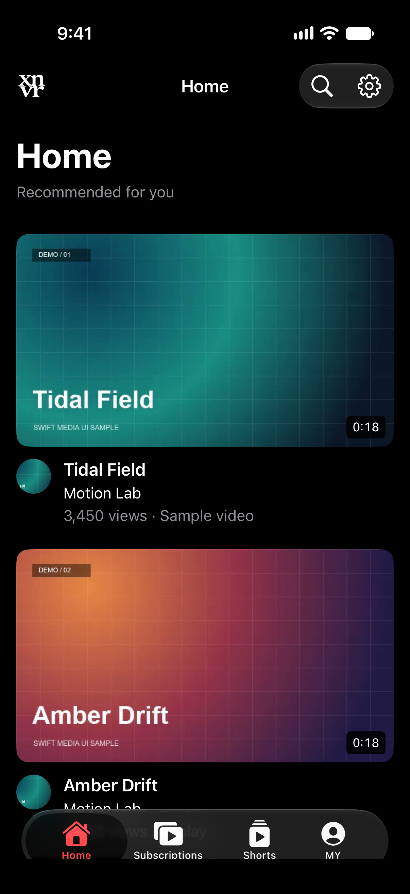
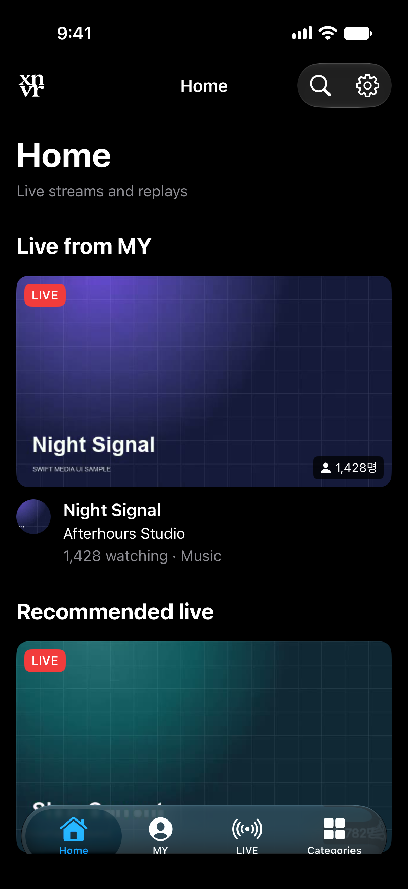
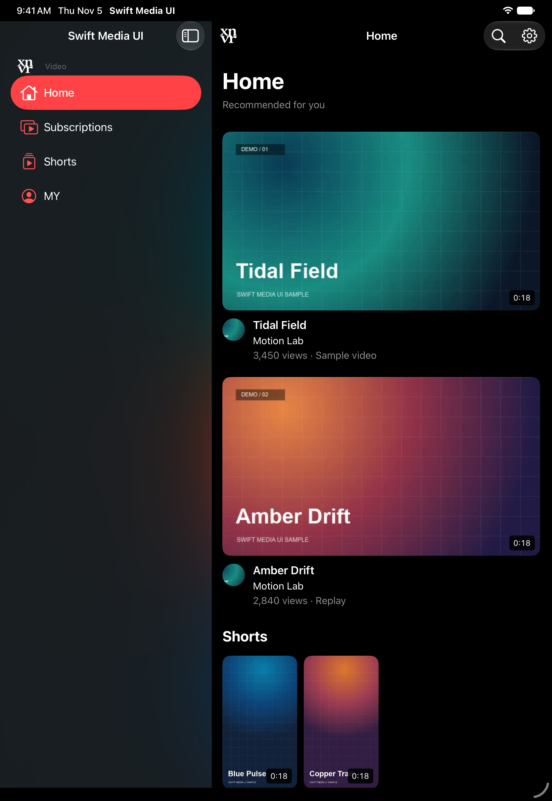
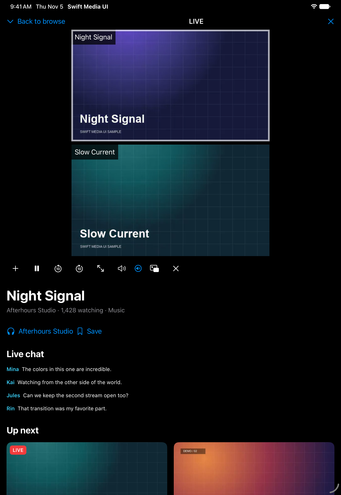
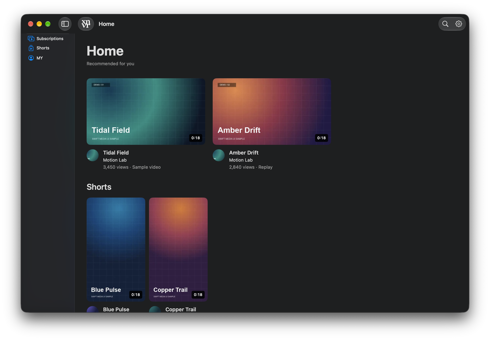
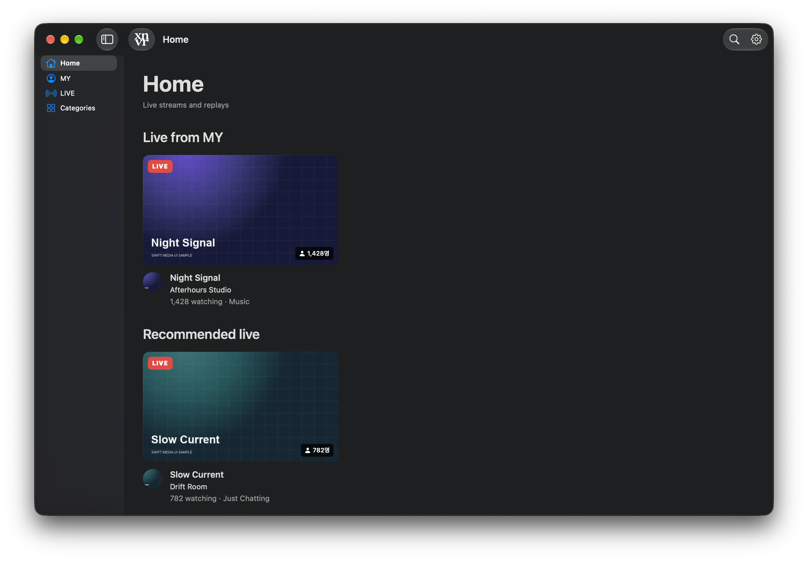
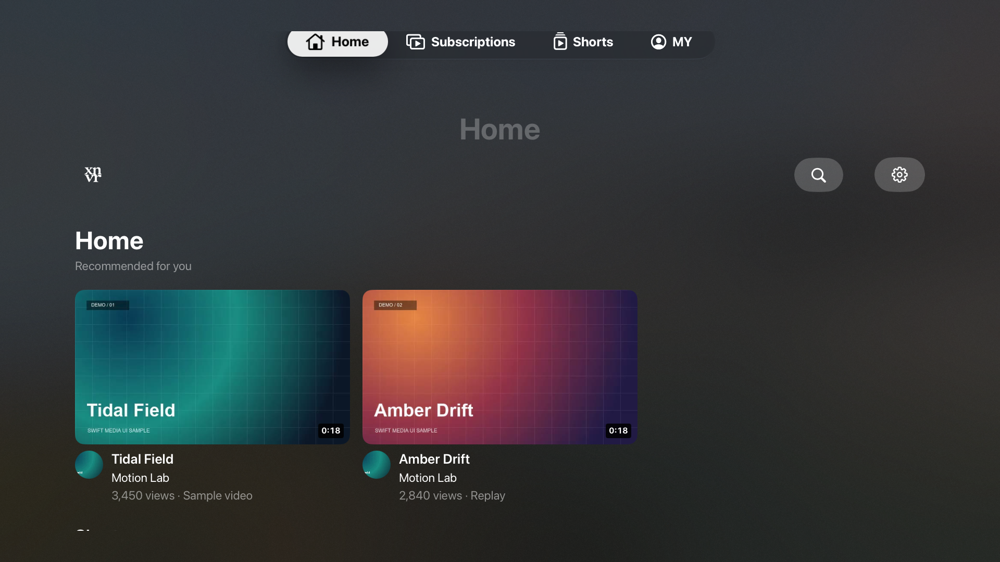
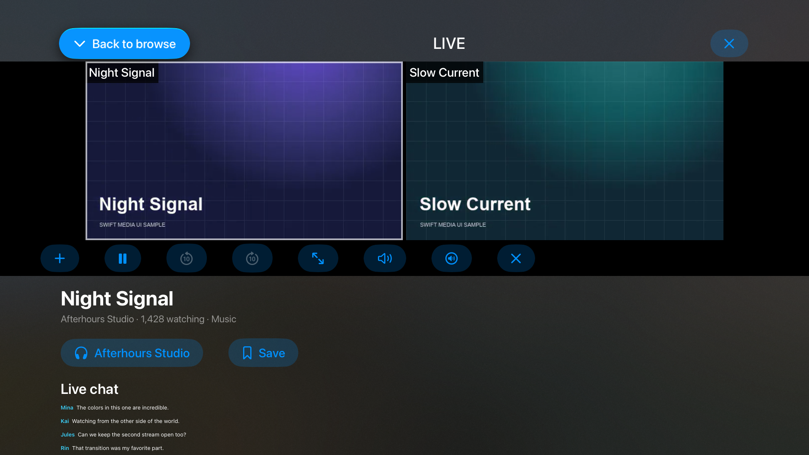

# Swift Media UI

Swift Media UI is a native Swift package for iPhone, iPad, Mac and Apple TV.
It provides a source-driven player and reusable SwiftUI and UIKit components for
media apps. It depends only on Apple SDKs.

## Features

- **Single video and multiview.** Open a playable URL, add videos from a source picker, and switch between a grid and an enlarged video.
- **Independent sessions.** Select or close one video while the others keep their playback state.
- **Playback and audio.** Play, pause and seek. Adjust each video's volume and mute, or apply a volume preset to all open videos.
- **Quality selection.** Use HLS automatic quality or expose the renditions your source supplies. Failed switches keep the previous item.
- **Picture in Picture.** Use native PiP on supported iPhone, iPad and Mac configurations. iPhone and iPad compose the multiview into a single PiP window.
- **Reusable components.** Compose video stages, media cards, badges, discussion panels, portrait paging and Apple TV focus controls.
- **Floating mini-player.** On iPhone and iPad, drag one or more video tiles together and snap them to any corner of the safe viewport.

## Demo app

The example uses the production media card, badge, navigation and discussion
patterns with bundled sample videos, channels, posts and chat. It runs offline.

- **Video** has Home, Subscriptions, Shorts and MY, with search, channel pages,
  posts, saved videos and watch history.
- **Live Platform** has Home, MY, LIVE and Categories, with sample streams,
  replays, clips, channel pages and chat.
- Open **Settings** to switch experiences. Both use the same `MediaPlayer`
  for single playback, multiview, quality and audio controls. Collapse the
  player to keep watching while you browse.

### Screenshots

Captured from the iPhone, iPad and Apple TV simulators and from the native Mac
app. Each row shows both experiences.

| Platform | Video | Live Platform |
| --- | --- | --- |
| iPhone |  |  |
| iPad |  |  |
| Mac |  |  |
| Apple TV |  |  |

## Install

Add the package in Xcode using `https://github.com/xnvr-inc/swift_media_ui.git`
and select the **MediaUI** library. The minimum deployment targets are iOS 17,
iPadOS 17, macOS 14 and tvOS 17.

```swift
import MediaUI

MediaPlayer(url: videoURL)
```

Pass an initial source and a list of available sources to enable the built-in
picker. Adding, closing, selecting and enlarging a video preserve the remaining
videos' sessions. Each video has its own volume and mute settings. The volume
menu has an **All videos** section during multiview.

```swift
let first = MediaPlaybackSource(url: firstURL, title: "First video")
let second = MediaPlaybackSource(url: secondURL, title: "Second video")

MediaPlayer(sources: [first], availableSources: [second])
```

Use `MediaPlayerController` when the host needs to add or close sources from
elsewhere in its UI. Give each logical video a stable ID if its URL can change.

## Sources and quality

AVFoundation handles supported MP4 and HLS URLs. HLS uses automatic quality
selection by default. To expose explicit choices, pass the qualities the
provider can supply and an asynchronous factory for fresh `AVPlayerItem`s.
The factory receives `nil` for automatic. Use it to refresh signed URLs or
prepare a custom AVFoundation asset. The player keeps the previous item when a
quality fails to load and offers retry. For seekable video it restores the
position when changing items.

```swift
let hd = MediaPlaybackQuality(id: "720p", title: "720p")
let source = MediaPlaybackSource(id: "episode-1", title: "Episode 1", qualities: [hd]) { quality in
    AVPlayerItem(url: quality == hd ? hdURL : automaticURL)
}
```

## Picture in Picture

On iPhone and iPad, a single video uses its AVPlayer layer for PiP. Multiview
uses a composite of decoded frames. A loading source keeps its place in the
grid and fills in when its first frame arrives. A source that stops supplying
frames keeps its latest frame. The Mac uses the PiP button in the native AVKit
video controls. Apple TV uses its remote-focus controls for in-app playback.

An iOS host enables **Audio, AirPlay, and Picture in Picture** in Background
Modes and configures its audio session for playback. Keep the player mounted
while PiP runs. A host can supply a callback to reveal its player on return.

## Components

The `MediaUI` module also exports `MediaVideoStage`, `PlaybackMultiviewLayout`,
`MediaPlaybackTiles`, `MediaVolumePresets`, video cards and badges, discussion
views, portrait paging, and Apple TV focus and side panels. Custom iPhone and
iPad players can supply AVPlayers or decoded frames through `MediaPiPSource`
and mount the `MediaMultiviewPictureInPicture` canvas inline. The host owns
its source resolution, audio mix and scene policy.

On Apple TV, set `TVMediaPlaybackTile.overviewMenu` to show a native context
menu when Select is held on a focused overview tile. Use `onLongPress` for a
direct hold action. A short press calls `onOpen`.

Wrap a compact `MediaPlayer` or a set of `MediaPlaybackTiles` in
`MediaMiniPlayerDock` for in-app playback. The dock takes a corner binding and
a `MediaMiniPlayerLayout`. The host supplies its safe area and any bottom
clearance for navigation. Keep the same player or session mounted as the dock
moves.

## Run the example

Open [MediaUIDemo.xcodeproj](Examples/MediaUIDemo.xcodeproj) in Xcode. Use
the `MediaUIDemo-iOS` scheme for iPhone and iPad, `MediaUIDemo-tvOS` for
Apple TV, and `MediaUIDemo-macOS` for Mac. Select a simulator or **My Mac**
and run. The project uses this checkout's MediaUI package and bundled clips.

The Mac example can also run through SwiftPM.

```sh
swift run MediaUIDemo
swift test
```

Add `--showcase-video` or `--showcase-live` to select the starting
experience, and `--showcase-watch` to open a sample multiview session.
To regenerate the Xcode project, run `xcodegen generate` from `Examples/`.

## Codex skill

Copy [skills/swift-media-ui](skills/swift-media-ui) into your Codex skills
directory, then use `$swift-media-ui` when integrating the package. The skill
covers source factories, platform focus, quality recovery and PiP verification.

```sh
mkdir -p "${CODEX_HOME:-$HOME/.codex}/skills"
cp -R skills/swift-media-ui "${CODEX_HOME:-$HOME/.codex}/skills/"
```

## License

[MIT](LICENSE).
