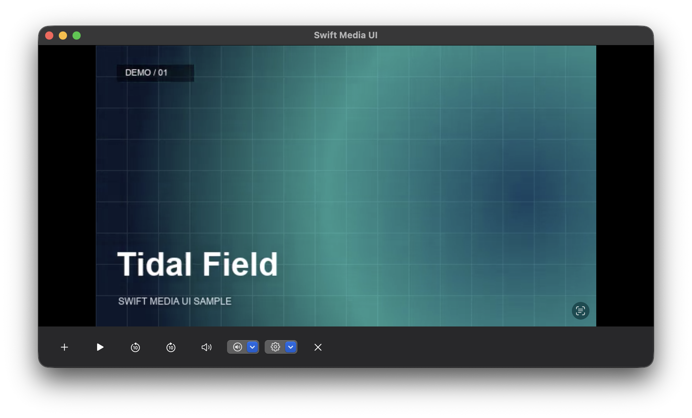
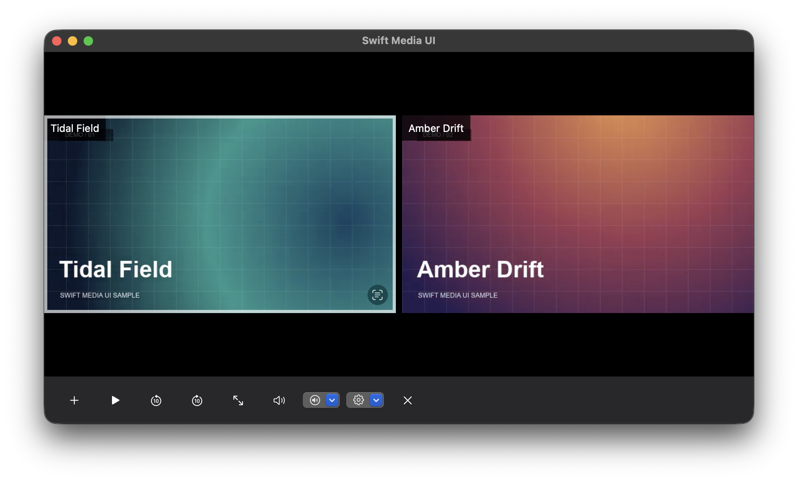

# Swift Media UI

Swift Media UI is a native Swift package for iPhone, iPad, Mac and Apple TV.
It provides a source-driven player and reusable SwiftUI and UIKit components for
media apps. It depends only on Apple SDKs.

## Features

- **Single video and multiview.** Open a playable URL, add videos from a source picker, and switch between a grid and an enlarged video.
- **Independent sessions.** Select or close one video while the others keep their playback state.
- **Playback and audio.** Play, pause and seek. Each video has its own volume and mute controls.
- **Quality selection.** Use HLS automatic quality or expose the renditions your source supplies. Failed switches keep the previous item.
- **Picture in Picture.** Use native PiP on supported iPhone, iPad and Mac configurations. iPhone and iPad can attempt a composite of the multiview.
- **Reusable components.** Compose video stages, media cards, badges, discussion panels, portrait paging and Apple TV focus controls.

## Screenshots

The macOS example playing its bundled sample clips.

| Single video | Two-video grid |
| --- | --- |
|  |  |

## Install

Add the package in Xcode using `https://github.com/xnvr-inc/swift_media_ui.git`
and select the **MediaUI** library. The minimum deployment targets are iOS 17,
iPadOS 17, macOS 14 and tvOS 17.

```swift
import MediaUI

MediaPlayer(url: videoURL)
```

Pass an initial source and a list of available sources to enable the built-in
picker. Adding, closing, selecting and enlarging a video preserve the remaining
videos' sessions. Each video has its own volume and mute settings.

```swift
let first = MediaPlaybackSource(url: firstURL, title: "First video")
let second = MediaPlaybackSource(url: secondURL, title: "Second video")

MediaPlayer(sources: [first], availableSources: [second])
```

Use `MediaPlayerController` when the host needs to add or close sources from
elsewhere in its UI. Give each logical video a stable ID if its URL can change.

## Sources and quality

AVFoundation handles supported MP4 and HLS URLs. HLS uses automatic quality
selection by default. To expose explicit choices, pass the qualities the
provider can supply and an asynchronous factory for fresh `AVPlayerItem`s.
The factory receives `nil` for automatic. Use it to refresh signed URLs or
prepare a custom AVFoundation asset. The player keeps the previous item when a
quality fails to load and offers retry. For seekable video it restores the
position when changing items.

```swift
let hd = MediaPlaybackQuality(id: "720p", title: "720p")
let source = MediaPlaybackSource(id: "episode-1", title: "Episode 1", qualities: [hd]) { quality in
    AVPlayerItem(url: quality == hd ? hdURL : automaticURL)
}
```

## Picture in Picture

On iPhone and iPad, the PiP button is available when AVKit reports that the
selected video can enter PiP. With multiple videos, the player attempts a
composite using decoded frames and falls back to the selected video if the
composite cannot start. The Mac uses the PiP button in the native AVKit video
controls. Apple TV uses its remote-focus controls for in-app playback.

An iOS host enables **Audio, AirPlay, and Picture in Picture** in Background
Modes and configures its audio session for playback. Keep the player mounted
while PiP runs. A host can supply a callback to reveal its player on return.

## Components

The `MediaUI` module also exports `MediaVideoStage`, `PlaybackMultiviewLayout`,
`MediaPlaybackTiles`, video cards and badges, discussion views, portrait
paging, and Apple TV focus and side panels. Compose these independently when a
host needs a custom playback screen.

## Run the example

On a Mac with Xcode installed, run the example with the bundled sample clips.

```sh
swift run MediaUIDemo
```

**Tidal Field** opens first. Choose **Add video** to open **Amber Drift**.
Select Tidal Field to try its 360p and 180p renditions. The clips are synthetic
sample media. You can also pass your own paths or playable URLs.

```sh
swift run MediaUIDemo /path/to/first.mp4 /path/to/second.mp4
swift test
```

## Codex skill

Copy [skills/swift-media-ui](skills/swift-media-ui) into your Codex skills
directory, then use `$swift-media-ui` when integrating the package. The skill
covers source factories, platform focus, quality recovery and PiP verification.

```sh
mkdir -p "${CODEX_HOME:-$HOME/.codex}/skills"
cp -R skills/swift-media-ui "${CODEX_HOME:-$HOME/.codex}/skills/"
```

## License

[MIT](LICENSE).
